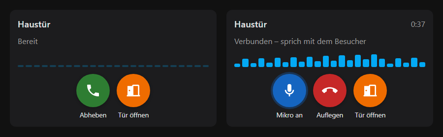

# Ring Intercom Talk Card



*Rendered from the card code with example data (no real Home Assistant). Right: an active call – the call state is simulated (no WebRTC connection in the preview).*

Lovelace card (`custom:ring-sprechen-card`) for two-way talk with a visitor at a **Ring Intercom** directly from a dashboard, using WebRTC through the camera entity of the **Ring Intercom Talk** integration (`ring_intercom_talk_ha_integration`, domain `ring_sprechanlage`).

UI language: German.

## Features

- Pick up / hang up, call timer
- Microphone button: tap = on/off, press and hold = push-to-talk
- Optional "busy" indicator (call active)
- Optional "open door" button (script, button, lock, switch or any service) with confirmation
- Optional auto pick-up when the card appears (e.g. in a doorbell popup)

## Requirements

- [ring_intercom_talk_ha_integration](https://github.com/SysriX/ring_intercom_talk_ha_integration) – provides `camera.<name>_gegensprechen`
- The [Ring](https://www.home-assistant.io/integrations/ring/) integration with a Ring Intercom
- **HTTPS** for the microphone (browsers only allow microphone access on secure origins); over plain `http://` you can only listen

## Installation

### HACS (custom repository)

1. HACS → ⋮ → **Custom repositories** → add `https://github.com/SysriX/ring_intercom_talk_ha_card`, category **Dashboard**.
2. Install the card from HACS and reload the browser.
3. HACS registers the resource automatically: `/hacsfiles/ring_intercom_talk_ha_card/ring_intercom_talk_ha_card.js` (JavaScript module).

### Manual

1. Copy `dist/ring_intercom_talk_ha_card.js` to `/config/www/ring_intercom_talk_ha_card.js`.
2. Settings → Dashboards → ⋮ → **Resources** → add `/local/ring_intercom_talk_ha_card.js` as **JavaScript module**.
3. Reload the browser.

## Configuration

```yaml
type: custom:ring-sprechen-card
entity: camera.front_door_gegensprechen               # required
gespraech_entity: binary_sensor.front_door_call_active # optional: show "busy"
tuer_action: script.open_front_door                   # optional: "open door" button
                                                      # (script.*, button.*, lock.*, switch.* or domain.service)
tuer_bestaetigen: true                                # confirm before opening (default true)
mikro_start: an                                       # an | aus – microphone on right after pick-up
auto_abheben: false                                   # pick up automatically when the card appears
titel: Front door                                     # optional (default "Gegensprechen")
```

## Credits

The WebRTC flow is based on ring-intercom-video-card by cmos486 (Apache-2.0).

## Notes

This card was built for the author's own home and tablets. Some defaults (entity ids, dashboard paths) reflect that setup and may need to be set explicitly in your configuration.

## Version

1.0.0

## License

MIT – see [LICENSE](LICENSE).
